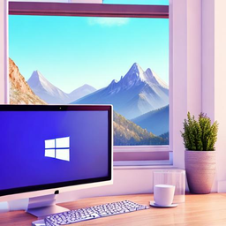
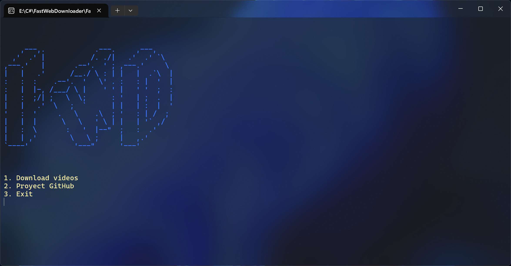
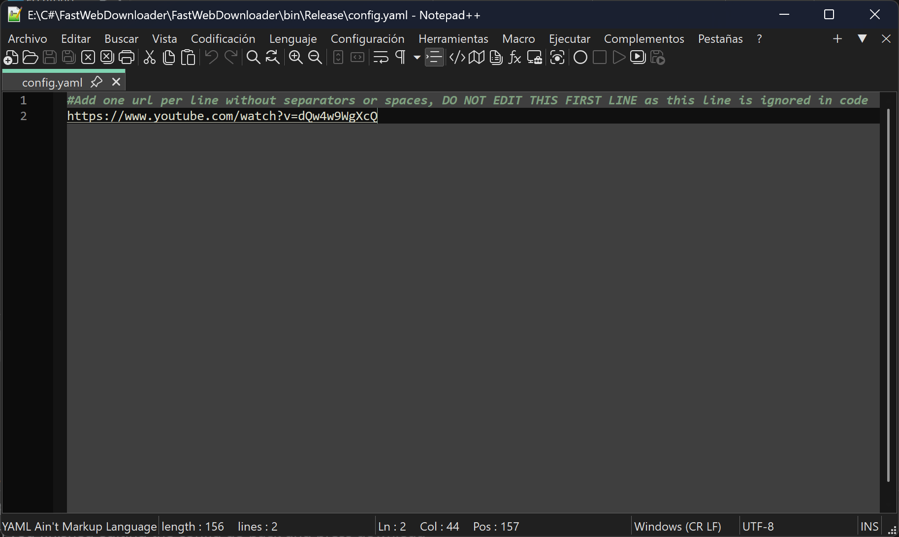
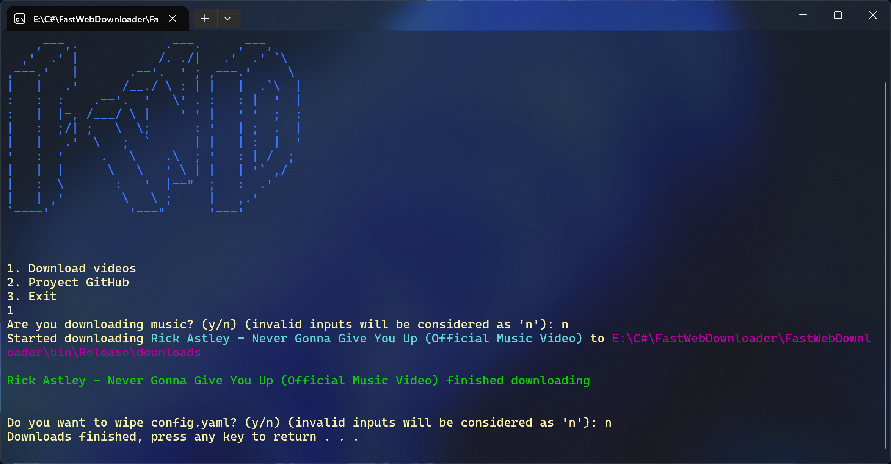

# FastWebDownloader

Bulk-download YouTube videos and playlists on Windows with a simple setup.

## Features

- Bulk download YouTube videos, channels and playlists
- Choose output format: audio-only or full video
- Portable configuration file (keep your settings alongside the app)
- No installation required (just extract and run)

## Screenshots

## Download and Installation

- Download: get the latest ZIP from the repository’s Releases page.
- Install: extract the ZIP and run the executable.
- No installation or admin privileges required.

## Usage

1. Run the app once to generate a config.yaml file in the same folder.
2. Open config.yaml and paste your YouTube URLs, one per line. Playlists are supported.
3. In the app, choose whether to download as Audio or Video.
4. Start the download and wait for it to complete.

Tips:
- Use full YouTube URLs for best results.
- You can mix single-video, full channel and playlist links in the same list.

## Configuration

- File: config.yaml (created on first run, stored next to the executable)
- Behavior: one YouTube link per line
- Portability: copy the executable and config.yaml together to move your setup to another machine

## Troubleshooting

- Invalid link: verify the URL opens in your browser.
- Network issues: check your connection or try again later.
- Playlist problems: ensure the playlist is public or unlisted (not private).
- Outdated build: if downloads fail unexpectedly after YouTube changes, update to the latest version.

If issues persist, please open an issue with:
- A brief description of the problem
- Example URL(s) (if possible)
- A screenshot of any error shown in the app

## Contributing

Contributions are welcome! To contribute:
- Open an issue to discuss the change or bug
- Fork the project and create a feature branch
- Submit a pull request with a clear description of your changes

## Reposting

Please do not repost the compiled .exe directly. Linking to this project’s GitHub page is allowed and appreciated.

## Legal and Use Disclaimer

- Use this tool only for content you own or have permission to download.
- Respect YouTube’s Terms of Service and copyright laws in your jurisdiction.
- Do not attempt to download DRM-protected content or circumvent any technical protection measures.
